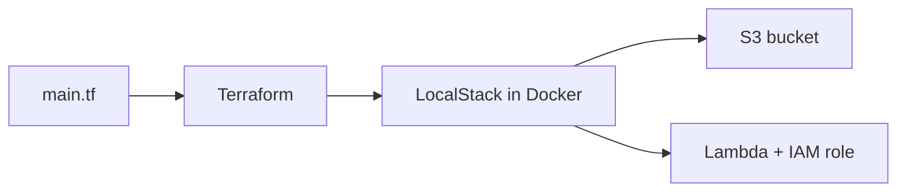

# terraform-localstack-aws

Verification code: WTC-5ZS3W93X

# Terraform + LocalStack AWS Practice

A practice project that builds AWS resources with Terraform on LocalStack, a fake AWS running on my laptop. It is a free way to learn Infrastructure as Code without a real AWS account.

## What it builds

- An S3 storage bucket with an `index.html` file in it
- A Python Lambda function with an IAM role

## Architecture



## Tools

Terraform, LocalStack, Docker, AWS CLI, Python, Git, GitHub Actions

## How to run it

1. Start Docker.
2. Create a free LocalStack account (Hobby plan) at app.localstack.cloud and copy your auth token. Never commit it.
3. Start LocalStack (full commands are in `NOTES.md`):
   ```bash
   export LOCALSTACK_AUTH_TOKEN="your-token-here"
   docker run --rm -d -p 4566:4566 -e LOCALSTACK_AUTH_TOKEN=$LOCALSTACK_AUTH_TOKEN -v /var/run/docker.sock:/var/run/docker.sock --name localstack localstack/localstack
   ```
4. Set fake AWS credentials:
   ```bash
   export AWS_ACCESS_KEY_ID=test
   export AWS_SECRET_ACCESS_KEY=test
   export AWS_DEFAULT_REGION=us-east-1
   ```
5. Build everything:
   ```bash
   terraform init
   terraform plan
   terraform apply
   ```
6. Test the function:
   ```bash
   aws --endpoint-url=http://localhost:4566 lambda invoke \
     --function-name hello-function \
     --cli-binary-format raw-in-base64-out \
     --payload '{"name":"Sam"}' response.json
   cat response.json
   ```
7. Clean up:
   ```bash
   terraform destroy
   docker stop localstack
   ```

## What I learned

- The Terraform workflow: init, plan, apply, destroy
- What S3 buckets, Lambda functions and IAM roles are
- Packaging Lambda code and deploying it with Terraform
- Running an AWS emulator in Docker
- Planning work with GitHub issues, a project board and pull requests
- Automatic checks with GitHub Actions

## Limitations

- This runs on LocalStack, not real AWS. Nothing is live on the internet.
- LocalStack now needs a free account and auth token to run.
- Some details differ between LocalStack and real AWS.